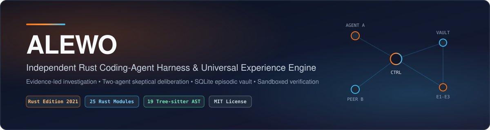

<p align="center">
  
</p>

<p align="center">
  <em>Evidence-led investigation, durable binary episodic memory, polyglot Tree-sitter analysis, two-agent skeptical deliberation, and sandboxed differential verification — built in pure Rust with zero hardcoded vulnerability scanners.</em>
</p>

---

## Why Alewo?

Most coding-agent harnesses rely on static rulebooks, regex vulnerability lists, or unbounded chat transcripts that drift and hallucinate on large repositories. **Alewo** takes a fundamentally different approach:

* **Pure Thinking-Level Steering:** Zero hardcoded CVE signatures, domain keywords, or file-name heuristics. Attention allocation is driven strictly by structural maps, mathematical prioritization (`focus_rank` & UCB `attention_schedule`), and source-derived state transitions (`@ALEWO-THINK/2`).
* **Two-Agent Skeptical Deliberation (`Agent A + Peer B`):** Agent A owns all tools and durable investigation state, while Peer B acts as a tool-less skeptical reasoning partner that challenges anchoring bias and proposes the smallest falsifying observation.
* **Universal Experience Engine (`SQLite + CBOR + Zstd`):** A 9-table local vault stores compressed, secret-redacted episodic lessons with Bayesian posterior scoring, UCB exploration, and benchmark-anchor redaction so verified methods transfer across repositories without leaking stale assumptions.
* **Machine-Checked Differential Verification (`E1 / E2 / E3`):** `finding_verify` independently validates verbatim `file:line` source anchors and executes isolated `reproduction` vs. `negative control` runs inside Bubblewrap (`bwrap`) sandboxes.
* **Single Native Binary:** Compiles to a self-contained Rust release binary with bundled SQLite and 19 Tree-sitter language grammars.

---

## Architecture

Alewo is organized into **25 Rust modules (~12.2K LOC)** across five cohesive layers:

```text
┌──────────────────────────────────────────────────────────────────────────┐
│                     CLI & Interactive REPL (/goal)                       │
│                   main.rs  •  chat.rs  •  config.rs                      │
└───────────────────────────────────┬──────────────────────────────────────┘
                                    │
┌───────────────────────────────────▼──────────────────────────────────────┐
│               Orchestrator & Cognitive Control Plane                     │
│  agent.rs  •  controller.rs  •  peer.rs  •  reasoning.rs  •  protocol.rs │
│  • focus_rank & UCB attention_schedule    • @ALEWO-THINK/2 ledger        │
│  • Agent A + Skeptical Peer B             • Cycle history folding        │
└───────────────┬─────────────────────────────────────────┬────────────────┘
                │                                         │
┌───────────────▼────────────────────┐  ┌─────────────────▼────────────────┐
│   Polyglot Structural & Code VM    │  │   Universal Experience Vault     │
│  polyglot_ast.rs • skeleton.rs     │  │  memory.rs   •  learning.rs      │
│  reachability.rs • invariants.rs   │  │  9-table SQLite + CBOR + Zstd    │
│  cognitive_vm.rs • tools_ext.rs    │  │  Density + Posterior + UCB rank  │
│  flow_index.rs   • php_ir.rs       │  │  Secret & anchor redaction       │
└───────────────┬────────────────────┘  └──────────────────────────────────┘
                │
┌───────────────▼──────────────────────────────────────────────────────────┐
│                Verification, Grounding & Sandboxed Runtime               │
│  verifier.rs • runtime_adapter.rs • source_guard.rs • grounding.rs       │
│  path_matrix.rs • state_matrix.rs • provider.rs (SSE streaming & pool)   │
└──────────────────────────────────────────────────────────────────────────┘
```

### Core Modules

| Module | Responsibility |
| :--- | :--- |
| `agent.rs` / `chat.rs` | Autonomous investigation loop, interactive TUI/REPL, continuous `/goal` cycles, tool dispatch, and cycle history folding |
| `controller.rs` | Durable investigation state machine, `focus_rank` entropy/attention scoring, UCB `attention_schedule`, and coverage tracking |
| `peer.rs` | Skeptical Peer B deliberation triggered by mathematical `debate_pressure` and posterior `consult_value` |
| `reasoning.rs` | `@ALEWO-THINK/2` transition algebra (`R`/`W`/`G`/`C`/`E`), canonical state tracking (`known_states`), and cross-anchor coupling |
| `memory.rs` / `learning.rs` | 9-table SQLite episodic vault (`CBOR + Zstd`), ranked retrieval, lineage tracking, and secret/benchmark-anchor redaction |
| `verifier.rs` / `runtime_adapter.rs` | `@ALEWO-VERIFY/2` (`E1`/`E2`/`E3`) differential gate with Bubblewrap (`bwrap`) adapters (`cargo_test`, `pytest`, `make_test`, `ctest`, `c_asan_file`, etc.) |
| `polyglot_ast.rs` / `skeleton.rs` | Tree-sitter structural indexing and 50–80% semantic skeleton compression preserving exact line numbers |
| `provider.rs` / `config.rs` | OpenAI-compatible SSE streaming client, multi-key pool (`NVIDIA_API_KEY_2`, etc.), configurable timeouts & transient retries (`~/.alewo/config.toml`) |

---

## Polyglot Code Intelligence

Bundled natively with **19 Tree-sitter grammars**:
`C` • `C++` • `Rust` • `Go` • `Python` • `JavaScript` • `TypeScript` • `Java` • `C#` • `PHP` • `Ruby` • `Bash` • `Lua` • `Zig` • `Elixir` • `HTML` • `CSS` • `JSON`

Provides zero-grep-noise structural navigation tools: `ws_read_multi`, `ws_read_symbol`, `ws_callers`, `ws_paths`, `ws_mutations`, `ws_flow_map`, `ws_slice`, and `ws_grep`.

---

## Getting Started

### Prerequisites

* **Rust** toolchain (`edition 2021`, `cargo` / `rustc`)
* Optional: **`bwrap` (Bubblewrap)** on Linux for isolated runtime verification adapters

### Build

```bash
git clone https://github.com/etch1n9/alewo.git
cd alewo
cargo build --release
```

The compiled binary is written to `target/release/alewo`.

### Configuration

1. Copy `.env.example` to `.env` and set your API key:

```bash
cp .env.example .env
# Edit .env and provide NVIDIA_API_KEY (and optional secondary keys for Peer B)
```

2. Optional global defaults can be configured in `~/.alewo/config.toml` (SSE timeouts, retry schedule, default `/goal` cycles, and rethink checkpoints).

---

## Usage

### Autonomous Investigation Mode

```bash
./target/release/alewo agent \
  --project /path/to/repo \
  --scope my-audit \
  --max-rounds 12 \
  --task "Audit state transitions and boundary checks across the codebase."
```

### Interactive Chat & Continuous `/goal` Mode

```bash
./target/release/alewo chat --project /path/to/repo
```

Inside interactive chat, use `/goal <objective>` for multi-cycle autonomous investigation with periodic rethink checkpoints and cycle history folding.

### Protocol Calibration & Tool Schema Inspection

```bash
./target/release/alewo tool-schema
./target/release/alewo protocol calibrate
```

---

## Verification & Safety Philosophy

* **Read-Only by Default:** Workspace mutations (`ws_replace`, `ws_create_file`) are disabled unless `--allow-write` is explicitly passed.
* **No Hidden Oracles:** `verifier.rs` checks only transparent repository files and sandboxed runtime outputs (`E1`: source failed, `E2`: source anchors verified, `E3`: source + differential reproduction vs. negative control verified).
* **Secret Hygiene:** Local `.env`, SQLite memory vaults, and session logs are excluded via `.gitignore` and guarded by automated redaction inside `memory.rs`.

---

## License

Licensed under the [MIT License](LICENSE).
